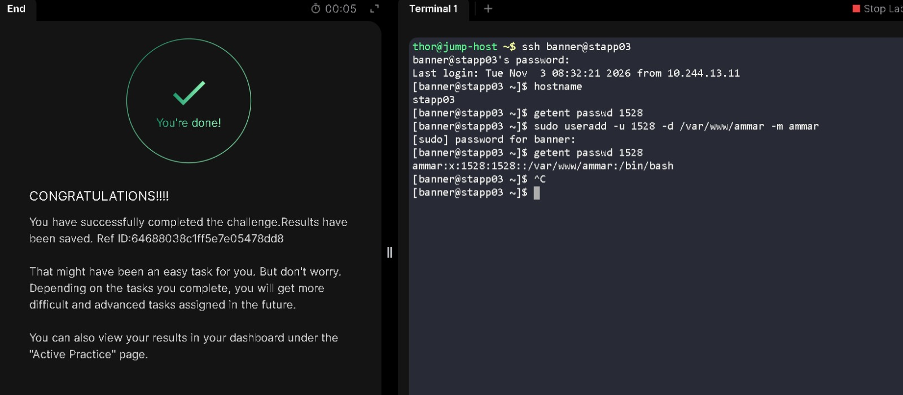

# Create a Custom Apache User 

**Date:** 3 November 2026  
**Platform:** KodeKloud — xFusionCorp Industries, Stratos Datacenter  
**Target Server:** App Server 3 (`stapp03`)  
**Category:** Linux User Administration

## Objective

My objective was to create a dedicated Linux user named `ammar` on App Server 3. The account required the unique UID `1528` and the home-directory path `/var/www/ammar`.

## Key Concepts

- **Linux user accounts and UIDs:** In Linux, we usually work with usernames, but each user also has a numeric ID called a UID (User ID). Linux uses this number to identify the account internally. In this task, the user `ammar` needed a specific UID (`1528`), so I had to provide that number when creating the account.

- **Home directory:** A home directory is where a user's personal files and settings are normally stored. Most regular users have a home directory under `/home`, but we can also choose a different location. For this task, the required home directory was `/var/www/ammar`.

- **Dedicated users for services:** Services such as Apache can use their own Linux accounts instead of running under a regular user's account. Keeping a separate account helps manage service-related ownership and permissions. In this task, I created the requested `ammar` account, but I did not change Apache's configuration to make the service run as this user.
  
## Execution & Terminal Output

### 1. Connect to App Server 3

From the jump host, I connected to `stapp03` and checked the hostname:

```bash
ssh banner@stapp03
hostname
```

Output:

```text
stapp03
```

### 2. Check for a UID conflict

Before creating the account, I checked whether UID `1528` was already present:

```bash
getent passwd 1528
```

The command returned no output, so I did not find an existing account with that UID in the account database.

### 3. Create the user

I ran the following command:

```bash
sudo useradd -u 1528 -d /var/www/ammar -m ammar
```

The command returned to the shell prompt without displaying an error.

The options I used were:

- `-u 1528`: assigns UID `1528`.
- `-d /var/www/ammar`: sets the account's home-directory path.
- `-m`: requests creation of the home directory.
- `ammar`: specifies the username.

## Verification

I queried the account database again to check the new account:

```bash
getent passwd 1528
```

Output:

```text
ammar:x:1528:1528::/var/www/ammar:/bin/bash
```

| Field | Recorded value |
|---|---|
| Username | `ammar` |
| UID | `1528` |
| Primary GID | `1528` |
| Home directory | `/var/www/ammar` |
| Login shell | `/bin/bash` |

This output confirms that the account database contains the requested username, UID, and home-directory path.

## Lessons Learned & Notes

- **Checking UIDs first:** The initial `getent passwd 1528` query returned no output. Checking first helped me avoid assigning a UID that was already listed in the account database.
- **A missed verification step:** I learned that seeing the home-directory path in the account database does not by itself prove that the directory exists on the filesystem. I used the `-m` option to request its creation, but I forgot to run `ls -ld /var/www/ammar` to check the directory directly.
- **Improving my verification routine:** In a future run, I will check the account with `id ammar` and inspect the home directory with `ls -ld /var/www/ammar`. These checks provide additional evidence beyond the passwd database entry.

## Skills Practiced / Key Takeaways

- Connecting to a remote Linux server over SSH.
- Confirming the target host with `hostname`.
- Checking for an existing UID with `getent`.
- Creating a Linux user with a specified UID and home-directory path.
- Requesting home-directory creation with `useradd -m`.
- Reading account information from the passwd database.

## Terminal Session

I have included my actual terminal session in a separate text file. It contains the commands I ran and the outputs from the task.

[View my actual terminal session](logs/01-create-apache-user.log)

## Task Completion Evidence


