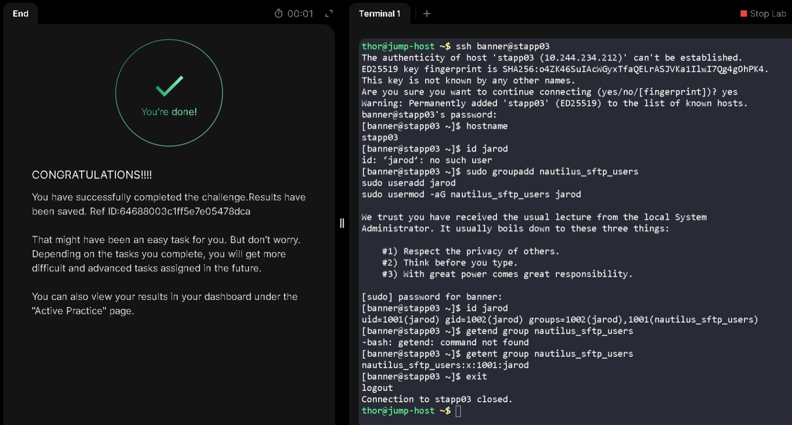

# Configure the SFTP User Group

Date: 3 November 2026  
Platform: KodeKloud — xFusionCorp Industries, Stratos Datacenter  
Target Servers: App Server 1 (`stapp01`), App Server 2 (`stapp02`), App Server 3 (`stapp03`)  
Category: Linux User & Group Administration

## Objective

My objective was to create the `nautilus_sftp_users` group on all three App servers and add the user `jarod` to that group. If the user did not exist, I needed to create it first.

## Execution & Terminal Output

### 1. Connect to the App servers and check the initial state

I connected to each App server and checked the hostname. I also checked whether `jarod` and `nautilus_sftp_users` already existed:

```bash
hostname
id jarod
getent group nautilus_sftp_users
```

On all three servers, `id jarod` reported that the user did not exist, and `getent group nautilus_sftp_users` returned no output. This showed that both the user and group needed to be created.

### 2. Create the group and user

I created the group with `groupadd` and created `jarod` with `useradd`. Both commands require administrative privileges, so I used `sudo`.

```bash
sudo groupadd nautilus_sftp_users
sudo useradd jarod
```

On App Server 1, my first attempt to run `groupadd` without `sudo` returned a permission error:

```text
Permission denied
cannot lock /etc/group; try again later.
```

I reran the command with `sudo`, and it completed without displaying an error.

### 3. Add `jarod` to the group

After creating the user and group, I added `jarod` to `nautilus_sftp_users`:

```bash
sudo usermod -aG nautilus_sftp_users jarod
```

The `usermod` command modifies an existing user account. The `-G` option specifies supplementary groups, while `-a` appends the group instead of replacing the user's existing supplementary group memberships.

On each server, I ran this command after both the user and group were present.

## Verification

I checked the group entry on all three servers using:

```bash
getent group nautilus_sftp_users
```

The results were:

| Server | Group entry |
|---|---|
| `stapp01` | `nautilus_sftp_users:x:1002:jarod` |
| `stapp02` | `nautilus_sftp_users:x:1001:jarod` |
| `stapp03` | `nautilus_sftp_users:x:1001:jarod` |

These entries show that `jarod` is listed as a member of `nautilus_sftp_users` on all three servers.

I also checked the user details with `id jarod` :

```text
uid=1001(jarod) gid=1002(jarod) groups=1002(jarod),1001(nautilus_sftp_users)
```

## Lessons Learned & Notes

- Administrative commands that modify system account files require appropriate privileges. The initial `groupadd` attempt on `stapp01` failed without `sudo`; using `sudo` resolved the permission issue.
- I mistyped `getent` as `getend` once on `stapp03`. The mistyped command was not found, so I reran it with the correct spelling.
- Local group IDs do not have to match across separate servers. The important check for this task was that the required group existed and listed `jarod` on each server.

## Skills Practiced

- Checking local users and groups with `id` and `getent`.
- Creating users and groups with `useradd` and `groupadd`.
- Adding a user to a supplementary group with `usermod -aG`.
- Using `sudo` for administrative account-management commands.
- Verifying group membership across multiple Linux servers.

## Terminal Session

I have included my actual terminal session in a separate log file. It contains the commands I ran and the outputs from the task.

[View my actual terminal session](logs/02-configure-sftp-user-group.log)

## Task Completion Evidence


