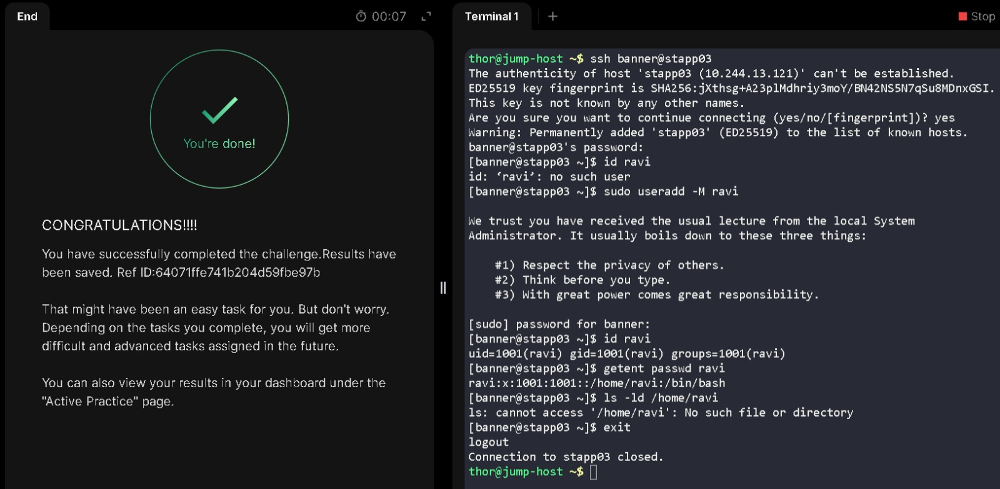

# Create a Service User Without a Home Directory

**Date:** 5 November 2026  
**Platform:** KodeKloud — xFusionCorp Industries, Stratos Datacenter  
**Target Servers:** App Server 3 (`stapp03`)  
**Category:** Linux User Administration

## Objective

Create the service user `ravi` on App Server 3 (`stapp03`) without creating a home directory.

## Execution & Terminal Output

### 1. Connect and Verify Initial State

I connected to `stapp03` as `banner` and ran `id ravi` to confirm the account didn't already exist. I left the standard SSH login output out of this document to keep it easy to read.

### 2. Create the User

```bash
sudo useradd -M ravi
```

The `-M` option stops `useradd` from creating a home directory. Without this flag, the command follows the server's default settings, which may create a directory depending on the system configuration.

## Verification

I checked both the account database and the filesystem:

```bash
id ravi
getent passwd ravi
ls -ld /home/ravi
```

```text
[banner@stapp03 ~]$ id ravi
uid=1001(ravi) gid=1001(ravi) groups=1001(ravi)

[banner@stapp03 ~]$ getent passwd ravi
ravi:x:1001:1001::/home/ravi:/bin/bash

[banner@stapp03 ~]$ ls -ld /home/ravi
ls: cannot access '/home/ravi': No such file or directory
```

The `/home/ravi` path is recorded in the passwd database, but the `ls` check confirms that the directory was not created on the filesystem. This verifies that the account was created without a home directory.

## Lessons Learned & Notes

- **Configured path vs. actual directory:** The `getent passwd` output can list a home-directory path such as `/home/ravi` even when that directory does not exist. Checking the filesystem with `ls -ld` confirms whether the directory was actually created.
- **Control the home directory explicitly:** Relying on the system's default `useradd` settings can cause unexpected results across different servers. It is better to use `-m` to create a directory or `-M` to prevent it, so the result is clear and predictable.

## Skills Practiced

- Checking local account state with `id` and `getent`.
- Creating a local Linux user without creating a home directory (`sudo useradd -M`).
- Checking the actual `/home` directory on disk to verify the passwd file record.

## Terminal Session

The complete terminal session is available in the separate log file.

[View my actual terminal session](logs/04-create-user-no-home-directory.log)

## Task Completion Evidence



---
