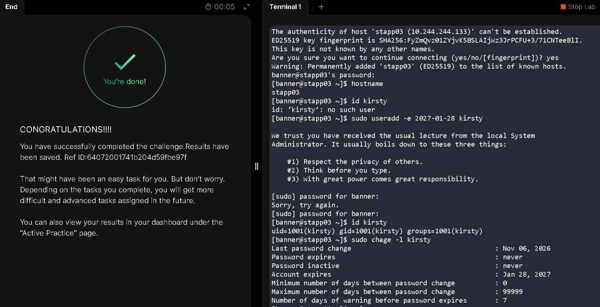

# Create a Temporary User with an Expiry Date

**Date:** 6 November 2026  
**Platform:** KodeKloud — xFusionCorp Industries, Stratos Datacenter  
**Target Servers:** App Server 3 (`stapp03`)  
**Category:** Linux User Administration

## Objective

I needed to create the lowercase user account `kirsty` on App Server 3 for a temporary project assignment. The account had to expire on `2027-01-28`.

## Execution & Terminal Output

### 1. Connect to App Server 3 and check whether the user exists

I connected to `stapp03` from the jump host and confirmed the target hostname. The initial account check showed that `kirsty` did not exist.

```bash
ssh banner@stapp03
hostname
id kirsty
```

```text
stapp03
id: ‘kirsty’: no such user
```

### 2. Create the user with an account expiry date

I used `useradd` with the `-e` option to set the account expiry date while creating the user.

```bash
sudo useradd -e 2027-01-28 kirsty
```

I mistyped the sudo password on the first attempt. I re-entered it correctly on the second prompt, and the command executed successfully.

```text
[sudo] password for banner:
Sorry, try again.
[sudo] password for banner:
```

### 3. Confirm the account and inspect its expiry settings

I checked that the account had been created and used `chage -l` to inspect its account-aging information.

```bash
id kirsty
sudo chage -l kirsty
```

```text
uid=1001(kirsty) gid=1001(kirsty) groups=1001(kirsty)
Last password change                                    : Nov 06, 2026
Password expires                                        : never
Password inactive                                       : never
Account expires                                         : Jan 28, 2027
Minimum number of days between password change          : 0
Maximum number of days between password change          : 99999
Number of days of warning before password expires       : 7
```

The `-l` option displays the account's password-aging information. The `Account expires` field confirms the requested expiry date; `Password expires: never` is a separate password-aging setting.

## Verification

The `id` output confirmed that `kirsty` exists with UID and GID `1001`. The `chage -l` output showed `Account expires: Jan 28, 2027`, matching the requested date.

## Lessons Learned & Notes

- **Set expiry at creation:** The `useradd -e` option sets the account's expiry date during creation, so a separate expiry-setting command was not needed.
- **Distinguish account and password expiry:** `chage -l` displays these as separate settings. The account was set to expire on January 28, 2027, while the password-expiry field remained `never`.
- **sudo password retries:** A mistyped password at the sudo prompt doesn't cancel the command. I just had to re-enter it, and useradd executed normally.
  
## Skills Practiced

- Creating a local Linux user account with a specific expiry date using useradd -e.
- Checking user identity and group information with `id`.
- Inspecting account-aging settings with `chage`.
- Verifying user-account configuration on a remote Linux server.

## Terminal Session

The complete terminal session is available in the separate log file.

[View my actual terminal session](logs/05-create-user-expiry-date.log)

## Task Completion Evidence



---
