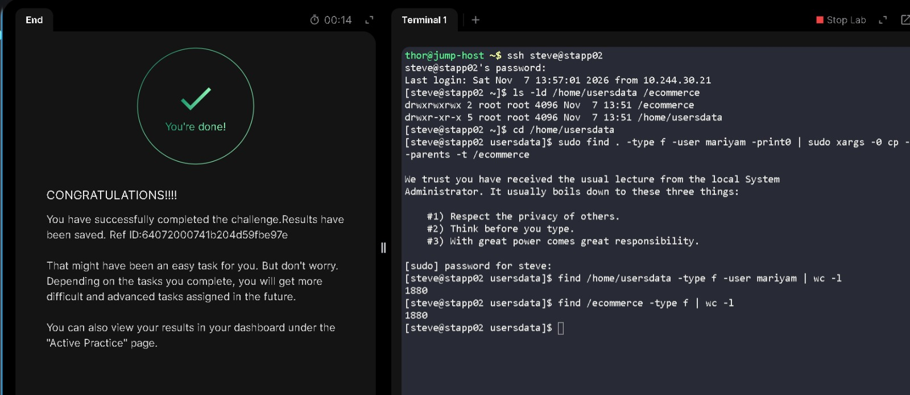

# Copy Mariyam's Files to the Ecommerce Directory

**Date:** 7 November 2026  
**Platform:** KodeKloud — xFusionCorp Industries, Stratos Datacenter  
**Target Servers:** App Server 2 (`stapp02`)  
**Category:** Linux File Management

## Objective

I needed to locate every regular file owned by `mariyam` under `/home/usersdata` on App Server 2 and copy it to `/ecommerce` while preserving the directory structure.

## Execution & Terminal Output

### 1. Connect to App Server 2 and check the directories

I connected to `stapp02` and checked that both the source and destination directories existed:

```bash
ssh steve@stapp02
ls -ld /home/usersdata /ecommerce
```

```text
drwxrwxrwx 2 root root 4096 Nov  7 13:51 /ecommerce
drwxr-xr-x 5 root root 4096 Nov  7 13:51 /home/usersdata
```

### 2. Find and copy Mariyam's files while preserving their paths

From `/home/usersdata`, I ran the following command to find files owned by `mariyam` and copy them to `/ecommerce` while retaining their directory structure:

```bash
cd /home/usersdata
sudo find . -type f -user mariyam -print0 | sudo xargs -0 cp --parents -t /ecommerce
```

- `-type f` limits the search to regular files, excluding directories.
- `-user mariyam` selects files owned by `mariyam`.
- `-print0` and `xargs -0` pass filenames using null delimiters, which safely handles spaces and other special characters.
- `cp --parents` preserves each file's relative directory path beneath the destination.
- `-t /ecommerce` sets `/ecommerce` as the copy destination.

The command completed and returned to the shell prompt without reporting a copy error.

### 3. Verify the file counts without flooding the terminal

During my initial check, I ran `find /home/usersdata -type f -user mariyam` by itself. It printed thousands of file paths and flooded the terminal. After starting a fresh session, I used `wc -l` to count the matching source files and the files in the destination without displaying every path:

```bash
find /home/usersdata -type f -user mariyam | wc -l
find /ecommerce -type f | wc -l
```

```text
1880
1880
```

## Verification

The source search found **1,880 regular files** owned by `mariyam`. The destination contained **1,880 regular files** after the copy.

The matching counts support that all identified files were copied to `/ecommerce`. The copy command used `--parents` to retain their directory structure.

## Lessons Learned & Notes

- **Avoid terminal flooding:** Running `find` without limiting or counting its output flooded the terminal with thousands of paths. Using `wc -l` provided a concise count for verification.
- **Preserve paths during bulk copies:** `cp --parents` retained the source directory structure under `/ecommerce`, rather than placing all files in one directory.
- **Handle filenames safely:** Pairing `find -print0` with `xargs -0` avoids filename-splitting problems when paths contain spaces or special characters.

## Skills Practiced

- Finding and filtering files by owner and type with `find -type f -user`.
- Copying files in bulk with `xargs` and `cp`.
- Preserving directory paths during file transfers.
- Verifying file counts with `wc -l`.

## Terminal Session

I have included my actual terminal session in a separate log file. It contains the exact commands I ran and the outputs from the task.

[View my actual terminal session](logs/06-find-and-copy-user-files.log)

## Task Completion Evidence



---
