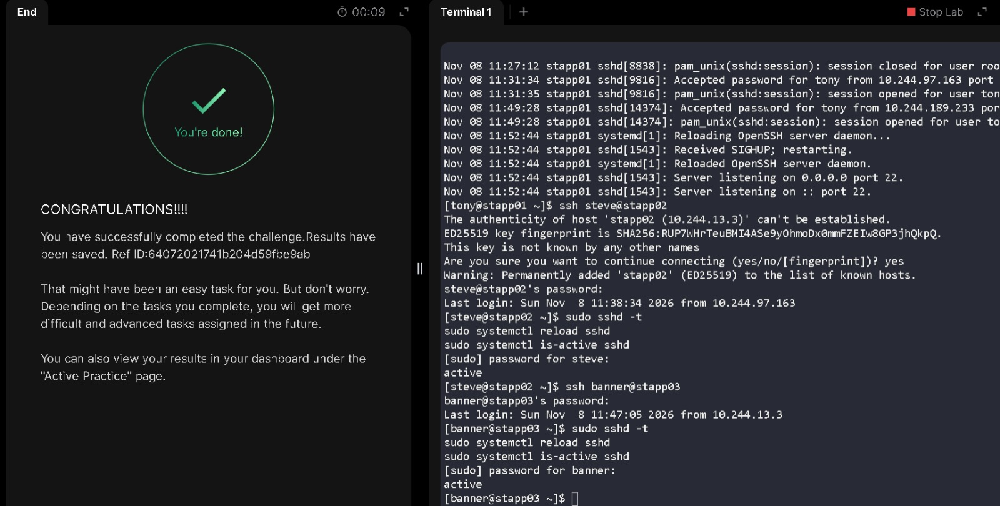

# Disable Direct Root SSH Login

**Date:** 2026-11-08  
**Platform:** KodeKloud — xFusionCorp Industries, Stratos Datacenter  
**Target Servers:** `stapp01`, `stapp02`, `stapp03`  
**Category:** SSH Hardening

## Objective

## Objective

Disable direct root SSH login across all three application servers (`stapp01`, `stapp02`, `stapp03`) to comply with the security team's updated access-control policies. The SSH configuration must then be validated and the service cleanly reloaded to apply the new security rules.

## Execution & Terminal Output

### 1. Disable direct root SSH login on all app servers

I connected to each application server using its assigned administrative user and edited `/etc/ssh/sshd_config` with `vim`.

```bash
sudo vim /etc/ssh/sshd_config
```

In `vim`, I searched for the setting by entering `/PermitRootLogin` in command mode, then pressed `i` to enter insert mode. I changed the active setting from `PermitRootLogin yes` to:

```text
PermitRootLogin no
```

I pressed `Esc` and saved the file with `:wq!`.

I checked the setting on each server with:

```bash
sudo grep PermitRootLogin /etc/ssh/sshd_config
```

The relevant output was the same on all three servers:

```text
#PermitRootLogin prohibit-password
# the setting of "PermitRootLogin without-password".
PermitRootLogin no
```

The active, uncommented `PermitRootLogin no` directive disables direct root SSH login. The commented examples are inactive.

### 2. Validate the configuration and reload SSH

After editing the configuration, I ran the syntax check and reloaded the SSH daemon on each server.

```bash
sudo sshd -t
sudo systemctl reload sshd
sudo systemctl is-active sshd
```

`sshd -t` returned no output, indicating that the configuration passed the syntax check. The service check returned:

```text
active
```


## ✅ Verification

To confirm the security policy was successfully applied, the configuration and service state were validated across all three nodes.

| Server | `PermitRootLogin` | Syntax Check (`sshd -t`) | Service State |
| :--- | :--- | :--- | :--- |
| `stapp01` | `no` | Passed | `active` |
| `stapp02` | `no` | Passed | `active` |
| `stapp03` | `no` | Passed | `active` |

The `PermitRootLogin no` directive is now present on every application server, and the `sshd` daemon is actively running on the updated configuration. This confirms the restriction of direct root access is fully enforced.

## ⚠️ Lessons Learned & Notes

- **Optimize multi-server workflows:** Instead of editing all servers first and reloading them later, executing the full "edit-validate-reload" cycle per server would reduce unnecessary SSH hopping
- **Use vim search for speed:** Navigating large configuration files manually is inefficient. Typing `/PermitRootLogin` in `vim` command mode jumped instantly to the correct line, speeding up the process across multiple servers.
- **Always test SSH syntax:** Running `sshd -t` before reloading is a mandatory habit. A single typo in `sshd_config` can permanently lock an administrator out of a remote server.
- **Reloading vs. Restarting:** Using `systemctl reload sshd` instead of `restart` is critical for production. It applies the new security configuration without dropping currently active SSH connections.
- **Choose concise service checks:** I first used `systemctl status sshd`, which returned a lengthy service report. I switched to `systemctl is-active sshd` because it provided the exact information needed for this task with a simple `active` result.

## Skills Practiced

- Editing OpenSSH server configuration with `vim`.
- Disabling direct root SSH login with `PermitRootLogin no`.
- Validating SSH daemon configuration with `sshd -t`.
- Reloading and checking services with `systemctl`.
- Applying and verifying a security configuration change across multiple Linux servers.

## Terminal Session

I have included my actual terminal session in a separate log file. It contains the exact commands I ran and the outputs from the task.

[View my actual terminal session](logs/07-disable-root-ssh-login.log)

## Task Completion Evidence



---
