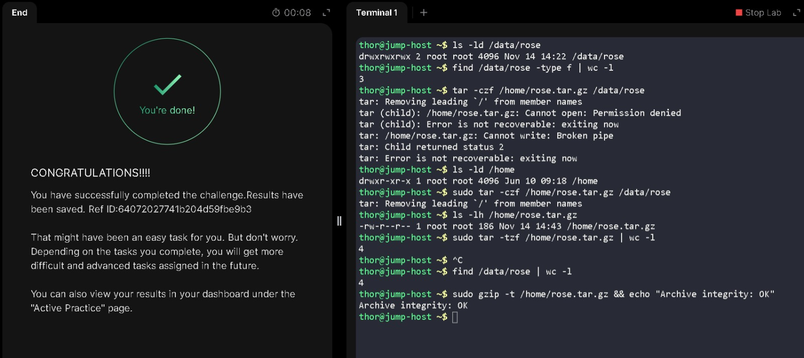

# Create a Compressed Archive of User Data

**Date:** 14 November 2026  
**Platform:** KodeKloud — xFusionCorp Industries, Stratos Datacenter  
**Target Servers:** Jump Host Server (`jump-host`)  
**Category:** Linux File Management & Archiving

## Objective

Developer `rose` requested a copy of their non-confidential data stored in `/data/rose`. The requirement is to create a compressed archive named `rose.tar.gz` of this directory and place the resulting archive into the `/home` directory on the Jump Host Server.

## Execution & Terminal Output

### 1. Check the source directory and its contents

I first confirmed that `/data/rose` existed and checked whether it contained any files or was empty.

```bash
ls -ld /data/rose
find /data/rose -type f | wc -l
```

```text
drwxrwxrwx 2 root root 4096 Nov 14 14:22 /data/rose
3
```

The directory existed and was not empty. It contained three regular files.

### 2. Create the compressed archive

I initially tried to create the archive directly in `/home` without elevated privileges.

```bash
tar -czf /home/rose.tar.gz /data/rose
```

```text
tar: Removing leading `/' from member names
tar (child): /home/rose.tar.gz: Cannot open: Permission denied
tar (child): Error is not recoverable: exiting now
tar: /home/rose.tar.gz: Cannot write: Broken pipe
tar: Child returned status 2
tar: Error is not recoverable: exiting now
```

The archive could not be written because the command did not have permission to create a file in `/home`. I checked the directory permissions to confirm the reason.

```bash
ls -ld /home
```

```text
drwxr-xr-x 1 root root 4096 Jun 10 09:18 /home
```

Since `/home` was owned by `root` and did not grant write permission to other users, I reran the archive command with `sudo`.

```bash
sudo tar -czf /home/rose.tar.gz /data/rose
```

```text
tar: Removing leading `/' from member names
```

The command completed successfully. The message means `tar` removed the starting `/` from the paths stored in the archive.

- `-c` creates a new archive.
- `-z` compresses it with gzip.
- `-f` specifies the archive filename.
- `sudo` allowed the command to write the archive into the root-owned `/home` directory.

### 3. Check the archive and compare its contents

I checked that `rose.tar.gz` had been created in the `/home` directory.

```bash
ls -lh /home/rose.tar.gz
```

```text
-rw-r--r-- 1 root root 186 Nov 14 14:43 /home/rose.tar.gz
```

I then checked what was inside the archive and counted its entries.

```bash
sudo tar -tzf /home/rose.tar.gz | wc -l
```

```text
4
```

I compared that number with the total number of entries in the source directory.

```bash
find /data/rose | wc -l
```

```text
4
```

The source directory contained three files plus the directory itself, giving four entries in total.

## Verification

Finally, I tested the gzip archive for integrity.

```bash
sudo gzip -t /home/rose.tar.gz && echo "Archive integrity: OK"
```

```text
Archive integrity: OK
```

The `rose.tar.gz` archive was present in `/home`, its four listed entries matched the four source filesystem entries, and the gzip integrity test passed.

## Lessons Learned & Notes

- **Check destination permissions:** The first `tar` attempt failed because the `thor` user account could not write to the `/home` directory. Checking its permissions explained the error, and rerunning the command with `sudo` resolved it.
- **Understand entry counts:** The source contained three regular files, but `find /data/rose | wc -l` returned four because it also counted the `/data/rose` directory itself. The archive listing count of four was therefore consistent.
- **Validate the compressed file:** Running `gzip -t` completed successfully, confirming that the generated gzip-compressed file passed the integrity check.

## Skills Practiced

- Inspecting directory ownership and permissions.
- Creating a gzip-compressed tar archive.
- Using `sudo` when writing to a root-owned destination.
- Listing and comparing archive and source entries.
- Checking gzip archive integrity.

## Terminal Session

I have included my actual terminal session in a separate log file. It contains the exact commands I ran and the outputs from the task.

[View my actual terminal session](logs/08-archive-user-data.log)

## Task Completion Evidence



---
