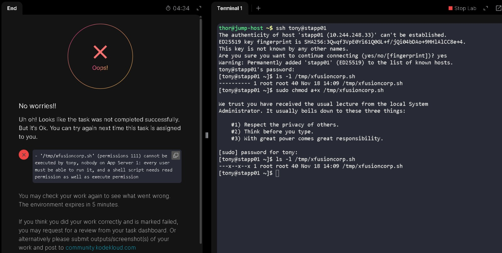
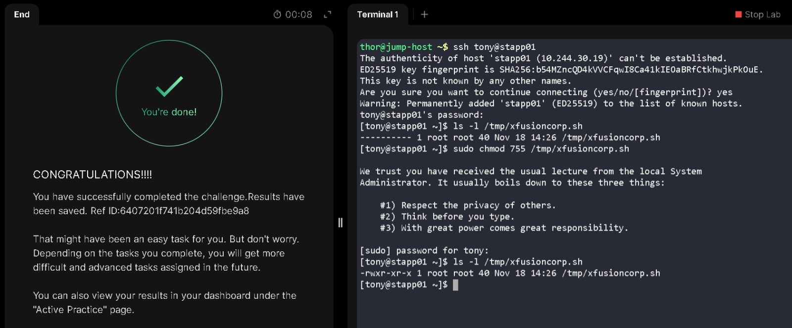

# Configure Shell Script Permissions

**Date:** 18 November 2026  
**Platform:** KodeKloud — xFusionCorp Industries, Stratos Datacenter  
**Target Servers:** App Server 1 (`stapp01`)  
**Category:** Linux File Permissions

## Objective

Grant executable permissions to the newly developed `/tmp/xfusioncorp.sh` backup script on App Server 1 (`stapp01`), ensuring that any user on the system can execute it directly without modifying the file's root ownership.

## Execution & Terminal Output

### 1. Connect to App Server 1 and inspect the initial permissions

I connected to `stapp01` as `tony` and checked the script's current permissions.

```bash
ssh tony@stapp01
ls -l /tmp/xfusioncorp.sh
```

Initial output:

```text
---------- 1 root root 40 Nov 18 14:09 /tmp/xfusioncorp.sh
```

The file was owned by `root`, and no permission bits were set for the owner, group, or others.

### 2. First attempt: Add execute permission for everyone

My first approach was to add execute permission to all three user classes.

```bash
sudo chmod a+x /tmp/xfusioncorp.sh
ls -l /tmp/xfusioncorp.sh
```

The command added execute permission for the owner, group, and others. The resulting output was:

```text
---x--x--x 1 root root 40 Nov 18 14:09 /tmp/xfusioncorp.sh
```

`a+x` adds execute permission for all user classes, but it does not add read permission. Since the file initially had no permissions, the resulting mode was `111`.

This configuration was incomplete. Unlike compiled binaries, a bash script must be readable by the interpreter (such as `/bin/bash`) so its contents can be processed. Because the file had no read permissions (`r`), it would still fail to run even though execute permission had been added.

### 3. Second attempt: Set the required permissions

I tried the task again and inspected the file before changing its permissions.

```bash
ssh tony@stapp01
ls -l /tmp/xfusioncorp.sh
```

Initial output in the second attempt:

```text
---------- 1 root root 40 Nov 18 14:26 /tmp/xfusioncorp.sh
```

I then set the permissions to `755`:

```bash
sudo chmod 755 /tmp/xfusioncorp.sh
ls -l /tmp/xfusioncorp.sh
```

The command completed, and the terminal showed:

```text
-rwxr-xr-x 1 root root 40 Nov 18 14:26 /tmp/xfusioncorp.sh
```

Mode `755` gives the owner read, write, and execute permissions, while the group and others receive read and execute permissions. This allows users other than the owner to read and execute the script without granting them write access.

## Verification

I checked the final permissions with:

```bash
ls -l /tmp/xfusioncorp.sh
```

```text
-rwxr-xr-x 1 root root 40 Nov 18 14:26 /tmp/xfusioncorp.sh
```

The final mode was `755` (`rwxr-xr-x`). The owner remained `root`, and both the group and other users had read and execute permissions.

KodeKloud confirmed that the second attempt was successful and saved the result.

## ⚠️ Lessons Learned & Notes

- **Scripts require read permissions:** I initially assumed adding the execute bit (`chmod a+x`) would be sufficient. However, unlike compiled binaries, shell scripts must be read by an interpreter (like `/bin/bash`) to run. Therefore, users must have both read and execute permissions (`+rx`).
- **Absolute vs. Symbolic modes:** Numeric `chmod` (like `755`) completely replaces and overwrites the existing permission set. In contrast, symbolic `chmod` (like `a+x`) only adds new bits to the current permissions without changing what is already there.

## Skills Practiced

- Inspecting Linux file permissions with `ls -l`.
- Modifying file permissions with `chmod`.
- Understanding symbolic and numeric permission modes.
- Troubleshooting script execution requirements by interpreting file permissions.
- Verifying access permissions on a Linux server.

## Terminal Session

I have included my actual terminal session in a separate log file. It contains the exact commands I ran and the outputs from the task.

[View my actual terminal session](logs/09-configure-script-permissions.log)

## Task Completion Evidence

**Attempt 1: Failed (Missing read permissions in mode 111)**


**Attempt 2: Passed (Successful 755 configuration)**

